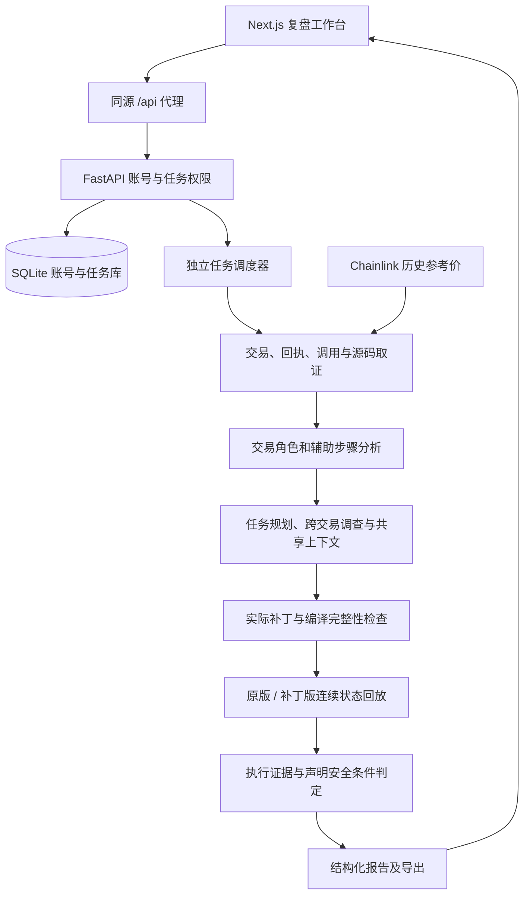

# 独立运行架构

## 提取范围

前端保留 AttackPilot 组件、样式、图标资源与账号隔离的浏览器存储。独立应用负责登录、注册、退出和页面布局，不加载原风控看板。浏览器只请求同源 API，模型和链上服务密钥保留在后端。

后端保留模块执行链及最小共享账号、安全、审计和模型配置代码。账号会话沿用 HttpOnly Cookie，私有任务继续按 owner 校验，公共归档保持只读。调度器管理后台子进程，任务的缓存和执行文件写入运行目录。

## 多交易的含义

输入集合中的交易先按区块号和交易索引排序，再构建合并资金图和初始调用树。交易角色是待进一步核对的分类，不能单独作为攻击成立或交易安全的证明。

调查器可在会话内已加载的交易间切换；共享记忆保存每笔交易的发现和当前分析上下文。回放选择保留用户提交的辅助步骤，在原版与补丁版两个独立分支中分别连续执行。

当前没有通用的链上关联交易发现器或辅助攻击交易合成器。序列末尾的只读安全条件探针用于测量结果，不是部署、授权或初始化攻击状态的准备交易。跨区块的执行时间覆盖也不等于自动重建期间全部外部交易。

## 结论与证据

任务执行结束、模型生成报告、补丁编译通过与攻击交易验证通过是不同状态。最终结论需要核对原始输入、实际补丁、执行文件和声明条件；证据缺失或冲突保留未确认或阻断。

机器检查与模型解释分别保存。公开历史报告用于展示已归档内容，不会因为独立打包而获得新的验证结论。

价格证据区分历史参考价与轨迹中实际观察到的 Feed 读取。美元参考估值不能替代资产数量证据，也不能自动合并成完整利润。
